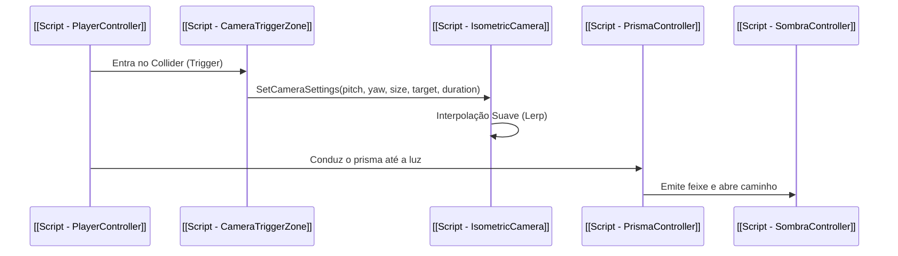

# 💻 MOC — Arquitetura & Scripts

Mapa de componentes de software do projeto Unity **ALBEDO**. Todo o código segue a arquitetura de componentes da Unity e as regras de eficiência de tokens.

- Retornar ao Início: [[000 - Home MOC]]
- Governança de Código: [[MOC - Otimização e Tokens]]

---

## 🧩 Scripts do Projeto

| Script | Função Principal | Linhas | Nota de Detalhe |
| :--- | :--- | :--- | :--- |
| `PlayerController.cs` | Movimentação WASD isométrica e pegar/soltar objetos [E] | 174 | [[Script - PlayerController]] |
| `PrismaController.cs` | Dispersão/projeção de feixe de luz e interação de cores | 366 | [[Script - PrismaController]] |
| `SombraController.cs` | Sombra física que se torna transponível ao ser iluminada | 135 | [[Script - SombraController]] |
| `IsometricCamera.cs` | Câmera isométrica ortográfica com interpolação dinâmica | 137 | [[Script - IsometricCamera]] |
| `CameraTriggerZone.cs`| Volume Trigger para alterar parâmetros da câmera por zona | 125 | [[Script - CameraTriggerZone]] |
| `LightSource.cs` | Ponto de luz emissor com gatilho físico e cor | 76 | [[Script - LightSource]] |
| `PickableObject.cs` | Objeto manipulável no cenário via tecla [E] | 73 | [[Script - PickableObject e Prompt]] |
| `InteractionPrompt.cs` | Feedback visual na UI da tecla de interação [E] | 56 | [[Script - PickableObject e Prompt]] |

---

## 💡 Fluxo de Execução entre Scripts

