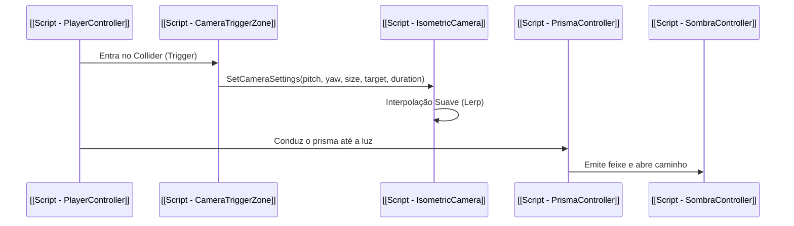

# 💻 MOC — Arquitetura & Scripts

Mapa de componentes de software do projeto Unity **ALBEDO**. Todo o código segue a arquitetura de componentes da Unity e as regras de eficiência de tokens.

- Retornar ao Início: [[000 - Home MOC]]
- Governança de Código: [[MOC - Otimização e Tokens]]

---

## 🧩 Scripts do Projeto

| Script | Função Principal | Linhas | Nota de Detalhe |
| :--- | :--- | :--- | :--- |
| `PlayerController.cs` | Movimentação WASD isométrica, pegar/soltar/acender [E] e rotacionar [Q]/[R] | 215 | [[Script - PlayerController]] |
| `PrismaController.cs` | Dispersão/projeção de God Ray volumétrico, encadeamento e mistura RGB aditiva | 298 | [[Script - PrismaController]] |
| `SombraController.cs` | Sombra física (Barreira por Cor RGB ou Passarela Caminhável no escuro) | 217 | [[Script - SombraController]] |
| `AlbedoColorUtility.cs` | Presets de cor, mistura aditiva RGB e correspondência de canais | 211 | [[Script - PrismaController]] |
| `GodRayBeam.cs` | Feixe volumétrico vertical/angular com partículas de poeira e raycast | 294 | [[Script - GodRayBeam]] |
| `GodRayTriggerZone.cs` | Sub-componente de gatilho físico para o GodRayBeam | 39 | [[Script - GodRayBeam]] |
| `LightSource.cs` | Ponto/volume de luz emissor com suporte a supressão por Fogo Negro | 192 | [[Script - LightSource]] |
| `TorchController.cs` | Tocha de Fogo Negro que suprime LightSources e GodRays no raio | 153 | [[Script - LightSource]] |
| `BlackFireBrazier.cs` | Braseiro que acende permanentemente a Tocha de Fogo Negro | 88 | [[Script - LightSource]] |
| `PickableObject.cs` | Objeto manipulável [E] e rotacionável [Q]/[R] preservando inclinação FBX | 167 | [[Script - PickableObject e Prompt]] |
| `LevelExitButton.cs` | Plataforma/botão final de conclusão do nível | 79 | [[Script - PlayerController]] |
| `IsometricCamera.cs` | Câmera isométrica ortográfica com interpolação dinâmica | 137 | [[Script - IsometricCamera]] |
| `CameraTriggerZone.cs`| Volume Trigger para alterar parâmetros da câmera por zona | 125 | [[Script - CameraTriggerZone]] |
| `InteractionPrompt.cs` | Feedback visual na UI da tecla de interação [E] | 56 | [[Script - PickableObject e Prompt]] |

---

## 💡 Fluxo de Execução entre Scripts

