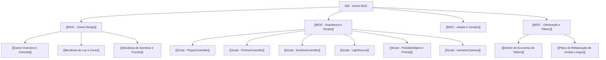

# 🌐 ALBEDO — Second Brain (Master MOC)

Bem-vindo ao **Second Brain** do projeto **ALBEDO**, estruturado com arquitetura **MOC (Map of Content)** para visualização perfeita no grafo do **Obsidian** e consulta ultra-eficiente de informações.

---

## 🗺️ Mapas de Conteúdo (MOCs Centrais)

Navegue rapidamente pelos tópicos do projeto:

1. **Game Design & Conceito**: [[MOC - Game Design]]
   - Ideia central, atmosfera, mecânicas de refração e luz, regras das sombras.
2. **Arquitetura de Código & Scripts**: [[MOC - Arquitetura e Scripts]]
   - Componentes C#, interações, ciclo de gameplay e controladores.
3. **Cenário, Modelos & Arte**: [[MOC - Assets e Cenário]]
   - Modelos FBX (`CenaAjeitada`, `prismateste`), materiais e iluminação isométrica.
4. **Governança, Performance & Tokens**: [[MOC - Otimização e Tokens]]
   - Aplicação da skill de economia de tokens, limite de 300 linhas e plano de modularização.

---

## ⚡ Atalhos Rápidos
- Regra de Otimização Ativa: [[Diretriz de Economia de Tokens]]
- Script mais complexo: [[Script - PrismaController]]
- Setup de Câmera: [[Script - IsometricCamera]]
