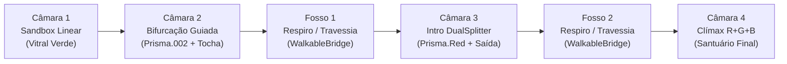

# 🔍 Auditoria Estrutural — Fase 1: *O Claustro dos Vitrais*

Diagnóstico da estrutura atual de [[Level Design - Fase 2 O Claustro dos Vitrais]] (`Fase1.unity`) sob a lente do [[Framework - Level Design de Puzzles no ALBEDO]] e do [[Estudo - Level Design de Portal 2 (Abram e Valve)]].

- Retorno: [[MOC - Game Design]]
- Documento Auditado: [[Level Design - Fase 2 O Claustro dos Vitrais]]
- Critérios Aplicados: [[Framework - Level Design de Puzzles no ALBEDO]]

---

## 📊 Visão Geral do Ritmo Atual

O macro-fluxo da Fase 1 já segue um **ritmo em serra saudável** (Câmaras de raciocínio intercaladas por travessias curtas com a `Tocha` nos Fossos 1 e 2) e respeita a progressão de complexidade (1 vitral → 2 vitrais → divisor óptico → convergência aditiva + filtro). Os principais ganhos potenciais estão em **leitura de causa-efeito, transporte de itens e prevenção de *overcomplication***.

---

## 🏛️ Diagnóstico Câmara a Câmara

### 1. Câmara 1 — Átrio do Vitral Verde `(0, 0)`
- **O que funciona bem:** Atua exatamente como uma **Câmara 1 (*sandbox* seguro e linear)** — apresenta `LightSource` amarela, `Prisma` branco (`Multiply`), `Vitral_Verde_Tutorial` (`SingleFilter`) e `Sombra` verde sem distrações.
- **Pontos de atenção:**
  - **Enquadramento inicial (`CameraTriggerZone`):** Garantir que, ao entrar, a câmera mostre simultaneamente a fonte amarela, o prisma, o vitral e a sombra bloqueando o sul (`-Z`), evitando que o jogador empurre o prisma na direção errada antes de ver o vitral.
  - **Feedback de regra:** Deixar visualmente óbvio que o vitral bloqueia o corpo do jogador, mas deixa a luz atravessar.

### 2. Câmara 2 — Galeria Bipartida `(0, -15.5)`
- **O que funciona bem:** Excelente **reforço** — o jogador reutiliza um único `Prisma_Galeria` sob `Luz.005` (Ciano) apontando primeiro para Oeste (liberar `Prisma.002` Azul) e depois para Leste (liberar `Pira` e `Tocha`).
- **Pontos de atenção:**
  - **Risco de avanço sem coleta (`Prisma.002`):** Como o lado Leste libera a saída pelo Fosso 1 mesmo que o jogador não tenha aberto ou recolhido `Prisma.002` no lado Oeste, há risco de o jogador avançar até a Câmara 4 e só lá descobrir que faltou um prisma.
  - **Atrito de transporte (`HeldObject` único):** Como o jogador segura um objeto por vez, levar a `Tocha` acesa e o `Prisma.002` pelo Fosso 1 exige viagens extras caso a transição entre patamares não tenha ponto de apoio claro.
  - **Consistência visual (`Grade_Vitral_Ciano`):** Na documentação, `Grade_Vitral_Ciano` aplica filtro `Blue`; visualmente o vitral precisa parecer **Azul** (não Ciano) para não confundir o cálculo mental do jogador.

### 3. Fosso 1 & Câmara 3 — Salão do Divisor Óptico `(+30, -15.5)`
- **O que funciona bem:** O Fosso 1 (`Sombra.003`) dá um respiro físico antes do conceito novo (`DualSplitter` em `Cristal_Divisor_1`), e o divisor abre ao mesmo tempo a recompensa (`Prisma.Red`) e a saída Norte (`Sombra.007`).
- **Pontos de atenção:**
  - **Leitura simultânea de duas saídas (Fiação Visual):** Sem linhas/guias diegéticas no piso conectando `Cristal_Divisor_1` tanto à `Sombra.004` (Leste) quanto à `Sombra.007` (Norte), o jogador pode tentar girar/mover o cristal ou achar que faltam prismas (*overcomplication*).
  - **Mesmo risco de coleta ignorada:** `Sombra.007` abre junto com `Sombra.004`; se o jogador sair direto para o Fosso 2 sem pegar `Prisma.Red`, terá backtracking obrigatório depois.

### 4. Fosso 2 & Câmara 4 — Santuário da Convergência `(+30, +15.0)`
- **O que funciona bem:** Clímax forte unindo todas as regras da fase: `Mesa` sob luz Magenta (`Prisma.Red` + `Prisma.002`) + `Slot_Externo_Verde` sob luz Amarela (`Prisma.003` → `Vitral_Verde_Final`) formando `R + G + B = Branco` na `Sombra.001`.
- **Pontos de atenção:**
  - **Densidade cognitiva alta:** Há duas fontes diferentes (`Luz.006` Magenta e `Luz_Altar_Verde` Amarela), dois conjuntos de encaixes (`Mesa` e `Slot_Externo_Verde`) e um vitral final. Sem **fiação visual no piso** apontando todas as linhas rumo à `Sombra.001`, jogadores tendem a complicar tentando levar todos os prismas para a mesma mesa.
  - **Interação sutil Tocha × GodRay:** `TorchController` suprime luzes e GodRays dentro de `suppressionRadius` enquanto acesa. Se o jogador pousar a tocha perto da `Mesa`, do `Slot_Externo_Verde` ou de `Sombra.001`, pode apagar os feixes acidentalmente sem entender o motivo.

---

## 🎯 Backlog Priorizado de Melhorias Estruturais

| Prioridade | Alvo | Ação Recomendada (Estrutural) | Princípio Relacionado |
| :--- | :--- | :--- | :--- |
| **P0** | Câmaras 2, 3 e 4 | Garantir que o jogador **não avance sem notar os prismas-chave** (`Prisma.002` e `Prisma.Red`), usando *sightline* forte no item ou porta/atalho de retorno rápido, e prever área neutra para pousar a `Tocha` longe dos feixes na Câmara 4 | Zero Soft-Lock & Antecâmara Segura |
| **P0** | Câmara 2 (`Grade_Vitral_Ciano`) | Alinhar cor visual/material e nomeação com o canal filtrado (`Blue`) para manter regra 100% honesta | Clareza & Confiança do Jogador |
| **P1** | Câmaras 3 e 4 | Adicionar **pistas visuais diegéticas no piso** (calhas/juntas sutis) ligando `Cristal_Divisor_1` às 2 sombras e ligando `Mesa` + `Slot_Externo_Verde` à `Sombra.001` | Fiação Visual (*Antlines*) |
| **P1** | Câmaras 1 a 4 | Revisar `CameraTriggerZone` em cada entrada para enquadrar objetivo + ferramentas na mesma vista e remover elementos decorativos que poluam a leitura | *Sightlines* & Moderação de Ruído |
| **P2** | Fossos 1 e 2 | Avaliar o fluxo de carregar `Tocha` + `Prisma.002` / `Prisma.Red` (ex.: validar se fazer 2 travessias por fosso agrega puzzle ou apenas repetição mecânica) | *Sawtooth Pacing* & Fluxo |
