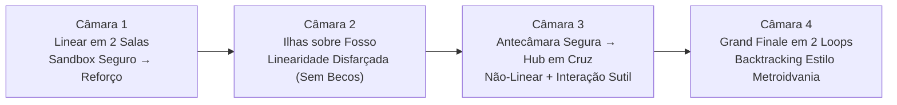

# 🧠 Estudo — Estrutura de Puzzles em *Portal 2* (Abram & Valve)

Síntese dos princípios estruturais de *Portal* / *Portal 2* (*Valve Developer Commentary*) e do estudo de caso de quatro câmaras de Abram Stanhope (`abramdesign.dev/Portal2Chambers`), com foco exclusivo em **como os puzzles são estruturados** — ritmo, topologia espacial, ensino sem texto e clareza de leitura — para servir de base metodológica no **ALBEDO**.

- Retorno: [[MOC - Game Design]]
- Aplicação no Projeto: [[Framework - Level Design de Puzzles no ALBEDO]]
- Auditoria Prática: [[Auditoria - Fase 1 Claustro dos Vitrais (Lente Portal)]]
- Template Derivado: [[Template - Blueprint de Câmara de Puzzle]]

---

## 🎯 Foco do Estudo: Estrutura, Não Mecânicas

> [!NOTE] Escopo Metodológico
> O objetivo aqui **não** é importar mecânicas de *Portal 2* (portais, géis, cubos ou pontes de luz) para o ALBEDO, mas absorver a **arquitetura de aprendizado e fluxo** que faz o jogador entender e resolver puzzles complexos sem frustração artificial.

---

## 🗺️ Estudo de Caso: Progressão das 4 Câmaras (`Portal2Chambers`)

No projeto de 4 câmaras sequenciais de Abram Stanhope (inspirado em *Portal*, *Portal 2*, *Portal Stories: Mel* e *Portal: Revolution*), a dificuldade escala pela **evolução da topologia espacial** e pela **combinação incremental de regras**:

1. **Câmara 1 — Linearidade Pura (2 Sub-salas):**
   - **Sala 1 (*Sandbox* Seguro):** Ambiente controlado para testar o comportamento básico da mecânica nova sem risco de erro punitivo.
   - **Sala 2 (Reforço):** Aplica a mesma mecânica em contexto mais exigente, mantendo layout estritamente linear para que o jogador **não se perca** enquanto consolida a regra.
2. **Câmara 2 — Linearidade Disfarçada ("Labirinto sem Becos sem Saída"):**
   - Introduz o hábito de **transportar um elemento-chave** consigo entre subáreas para desbloquear novos acessos.
   - Visualmente parece um espaço aberto com ilhas desconectadas, mas o fluxo real é direcionado e livre de *dead ends* que desperdicem o tempo do jogador.
3. **Câmara 3 — Hub Não-Linear com Antecâmara de Isolamento:**
   - Quando a mecânica envolve uma **interação sutil ou contra-intuitiva** (ex.: perder ou desativar um estado anterior ao cruzar uma barreira), a entrada funciona como área de processamento calma.
   - Só depois de entender o funcionamento isolado o jogador entra em um hub não-linear em cruz com múltiplas frentes simultâneas.
4. **Câmara 4 — *Grand Finale* em Loop Duplo (*Backtracking*):**
   - Ainda preserva uma zona segura inicial para o elemento inédito, mas estrutura o espaço inteiro para ser **resolvido duas vezes**.
   - **Loop 1** estabelece a geografia e libera novas partes da câmara; **Loop 2** reutiliza o mesmo espaço com maior complexidade e exigência de síntese (*pacing* inspirado em *Metroidvania*).

---

## 🔁 A Regra dos 3 Passos por Câmara

Tanto nas câmaras de Abram quanto na estrutura clássica da Valve, cada unidade de puzzle tende a seguir três batidas sequenciais:

1. **Introdução Isolada (*Teach*):** Apresenta a mecânica nova sozinha, em um espaço limpo onde testar é seguro e barato.
2. **Uso Adicional (*Reinforce*):** Pede que o jogador reaplique a mesma regra em uma variação ligeiramente diferente (outro ângulo, distância ou restrição).
3. **Síntese (*Combine / Twist*):** Mistura a mecânica recém-aprendida com conceitos de câmaras anteriores para gerar o momento *"Aha!"*.

---

## 🏛️ Pilares Estruturais da Valve (*Developer Commentary*)

### 1. Matriz de Interações (*Puzzle Design Matrix*)
- Antes de modelar paredes ou salas, mapeia-se uma matriz cruzando todas as mecânicas existentes no jogo.
- Cada célula de interseção revela uma **dinâmica emergente** (como Elemento A bloqueia, redireciona, transforma ou depende de Elemento B).
- O tema de uma câmara nasce dessa matriz, tratando o puzzle como um **grafo de estados** (*estado inicial → estados intermediários → estado de saída*).

### 2. Design Reverso (Da Saída para a Entrada)
- Em vez de inventar obstáculos pelo caminho, define-se primeiro a **condição final da solução** (o momento de clímax da sala) e caminha-se de trás para frente criando os pré-requisitos que levam até ela.
- Isso evita salas grandes com elementos sobrando e garante que toda peça colocada no nível participe da cadeia causal da solução.

### 3. *Sightlines* (Gestão de Linha de Visão)
- **Enquadrar o Objetivo:** Ao entrar na câmara ou concluir uma sub-etapa, o jogador deve enxergar naturalmente o próximo alvo ou porta de saída — a arquitetura atua como bússola silenciosa.
- **Controlar Sobrecarga Cognitiva:** Paredes, pilares e divisórias transparentes também servem para **ocultar** partes futuras do puzzle quando revelá-las cedo demais confundiria o jogador.
- **Hierarquia Visual:** Superfícies interativas devem se destacar imediatamente das paredes estruturais neutras.

### 4. Fiação Visual de Causa e Efeito (*Antlines*)
- Um bom puzzle não exige texto explicativo: a conexão entre **entrada** (o que o jogador manipula) e **saída** (o que muda no mundo) é desenhada no próprio cenário.
- Linhas luminosas no piso/parede permitem rastrear circuitos complexos com o olhar e oferecem feedback imediato quando um estado muda (ativo, inativo, invertido).

---

## 🧪 Lições Críticas de Playtest (Abram Stanhope)

1. **Autocontrole e Moderação de Ruído (*Noise Moderation*):**
   - Excesso de geometria decorativa, caminhos paralelos inúteis ou pistas falsas aumenta o ruído cognitivo.
   - Simplificar a sala ajuda o jogador a focar na relação lógica que realmente importa.
2. **O Viés da "Resposta Óbvia" e *Overcomplication*:**
   - O que parece óbvio para quem projetou raramente é óbvio para quem joga pela primeira vez.
   - Mesmo após compreenderem a mecânica correta, jogadores frequentemente **complicam demais a solução** tentando caminhos rebuscados se a leitura espacial do caminho simples não estiver cristalina.
