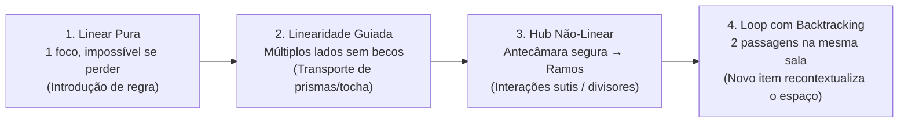

# 📐 Framework — Estruturação de Puzzles no ALBEDO

Guia prático para estruturar câmaras e fases no **ALBEDO**, aplicando os princípios de fluxo, ensino espacial e clareza do [[Estudo - Level Design de Portal 2 (Abram e Valve)]] exclusivamente sobre as mecânicas próprias do projeto.

- Retorno: [[MOC - Game Design]]
- Base Teórica: [[Estudo - Level Design de Portal 2 (Abram e Valve)]]
- Mecânicas do Projeto: [[Mecânica de Luz e Cores]], [[Mecânica de Sombras e Puzzles]], [[Mecânica de Vitrais e Divisores Cromáticos]]
- Aplicação Prática: [[Auditoria - Fase 1 Claustro dos Vitrais (Lente Portal)]] | [[Template - Blueprint de Câmara de Puzzle]]

---

## 🎯 Princípio Norteador: Estrutura Sem Copiar Mecânicas

O papel da referência de *Portal 2* no **ALBEDO** é puramente **estrutural**:
- Como isolar e ensinar uma regra sem texto tutorial.
- Como organizar o espaço (linear → guiado → hub → *backtracking*) para controlar dificuldade.
- Como tornar a relação entre causa e efeito óbvia no cenário, reduzindo ruído visual e *overcomplication*.

Todas as soluções devem nascer das interações entre `LightSource`, `PrismaController`, `ChromaticFilterGate`, `SombraController`, `TorchController`/`BlackFireBrazier` e `PrismSnapSlot`.

---

## 📈 Curva de Ritmo & Progressão de Topologias

### 1. Ciclo de Ensino em 3 Batidas (Por Conceito Novo)
1. **Isolamento Seguro (*Teach*):** O jogador testa uma única interação nova sem punição (ex.: um prisma + um vitral `SingleFilter` + uma `SombraController`).
2. **Reforço (*Reinforce*):** A mesma regra reaparece com uma variação espacial (ex.: girar o mesmo prisma entre dois vitrais diferentes).
3. **Síntese (*Combine / Twist*):** A regra recém-aprendida é combinada com elementos anteriores (ex.: dividir feixes com `DualSplitter` ou convergir R+G+B em Luz Branca).

### 2. Ritmo em Serra (*Sawtooth Pacing*)
Alternar picos cognitivos (câmaras de combinação densa) com momentos curtos de respiro/travessia (ex.: pontes `WalkableBridge` ou corredores de transição com *vista* da próxima sala).

### 3. Evolução de Topologias de Câmara

---

## 🧩 Matriz de Interações do ALBEDO (Geração de Temas)

Use esta matriz para gerar novos puzzles combinando mecânicas existentes antes de abrir o Unity Editor:

| Elemento Base | + `PrismaController` (`Multiply`/Aditivo) | + `ChromaticFilterGate` (`Single`/`Dual`) | + `SombraController` (`Barrier` / `Bridge`) | + `TorchController` & `BlackFireBrazier` |
| :--- | :--- | :--- | :--- | :--- |
| **`LightSource` (RGB / CMY)** | Define a cor disponível na sala; múltiplas fontes podem alimentar prismas distintos | Exige escolher a fonte certa para passar pelo filtro sem zerar o feixe (`R×B = 0`) | Luz do teto mantém `WalkableBridge` quebrada até ser suprimida | Tocha acesa suprime `LightSource` localmente (`suppressionRadius`), permitindo cruzar pontes ou anular feixes indesejados |
| **`PrismaController`** | **Convergência aditiva:** somar 2 ou 3 feixes na mesma sombra para formar cor composta ou Branco | `Vitral` bloqueia transporte do prisma (`isTrigger = false`), forçando projetar a luz à distância | Esculpe passagem em `Barrier` da cor exigida; se `allowPrismToOpenBridge = true`, pode derrubar pontes | Tocha acesa próxima apaga feixes de GodRay no seu raio de supressão (atenção a posicionamento e conflito intencional!) |
| **`ChromaticFilterGate`** | Encadear prismas após o vitral ou alimentar `DualSplitter` com cor composta (Amarelo/Ciano/Magenta) | **Filtragem em cascata:** extrair 1 canal primário por vez ou impedir retorno com trava anti-loop | Um único feixe em `DualSplitter` abre simultaneamente uma barreira de recompensa e uma barreira de saída | Separar fisicamente áreas onde a tocha pode ou não agir junto ao prisma |
| **`PrismSnapSlot`** | Fixa posição e *Yaw* do prisma para alinhamentos de precisão entre salas ou em convergência | Slot pré-alinhado aponta o prisma exatamente através de um vitral ou `DualSplitter` distante | Garante que o jogador não erre a solução por micro-desalinhamento angular | Permite posicionar prismas fixos enquanto carrega a tocha nas mãos |

---

## 👁️ Leitura Espacial Isométrica (*Sightlines* & Fiação Visual)

Em câmera ortográfica fixa/por zonas (`[[Script - IsometricCamera]]` e `[[Script - CameraTriggerZone]]`), o equivalente às *sightlines* e *antlines* de *Portal 2* funciona por enquadramento de topo e pistas diegéticas:

1. **Enquadramento da Entrada (`CameraTriggerZone`):**
   - Ao pisar em uma câmara, `Target Orthographic Size`, `Target Pitch/Yaw` e `Target Focus` devem enquadrar simultaneamente **o ponto de entrada, a fonte de luz e o bloqueio de saída**.
   - Se a câmara tiver subáreas (como um hub não-linear), use zonas de câmera separadas ou divisórias visuais para **não revelar todas as variáveis de uma vez**.
2. **Fiação Visual de Causa e Efeito (Sem Texto):**
   - **Indicação da cor exigida:** Usar `syncVisualColorIndicator` no `[[Script - SombraController]]` e molduras/tintas nos vitrais para mostrar exatamente qual cor cada barreira pede.
   - **Continuidade do feixe (`[[Script - GodRayBeam]]`):** O cone luminoso e o `GroundRing` na superfície atingida funcionam como linha viva conectando prisma → vitral → sombra.
   - **Trilhos/marcas sutis no piso:** Para câmaras com `DualSplitter` ou múltiplos `PrismSnapSlot`, marcas arquitetônicas no chão (calhas, juntas de pedra, tapetes de luz) ajudam o jogador a ler a geometria dos alinhamentos sem poluir a tela.

---

## ✅ Checklist de Validação de Câmara

Antes de finalizar o *blockout* de qualquer câmara:

- [ ] **Regra de 1 Conceito Novo:** A sala introduz no máximo 1 interação inédita (ou apenas combina regras já ensinadas)?
- [ ] **Sandbox Seguro:** Se há uma interação sutil/nova, existe uma área calma onde o jogador a entende antes de enfrentar o puzzle completo?
- [ ] **Design Reverso Verificado:** Toda fonte, prisma, vitral e slot presente na sala participa da solução ou tem função clara?
- [ ] **Moderação de Ruído:** Foram removidos pilares, luzes decorativas ou ângulos enganosos que induzem *overcomplication*?
- [ ] **Zero Soft-Lock de Transporte:** Se o jogador precisa levar um prisma ou a tocha após abrir uma passagem, o caminho de volta continua acessível (ou o item não fica preso atrás de um vitral/porta fechada)?
- [ ] **Câmara Resolvível Sem Precisão Chata:** Alinhamentos longos usam `PrismSnapSlot` ou margem de abertura confortável?
