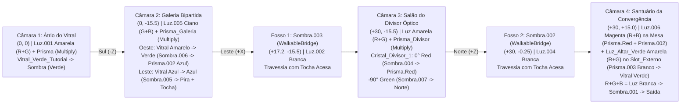

# 🏛️ Level Design — Fase 1 (Claustro dos Vitrais): *Layout em Z & Regra da Luz Branca*

Blueprint atualizado da cena [Fase1.unity](file:///E:/AAAAAAAAAAAALBEDO/AAAAAAAAAAAALBEDO/Assets/Scenes/Fase1.unity) baseado na regra central do **ALBEDO**: **a Luz Branca (`1, 1, 1` = `R + G + B`) é a junção de todas as cores e abre sombras de TODAS as cores**, enquanto luzes parciais exigem filtragem em vitrais ou convergência aditiva para somar Branco.

- Retorno: [[MOC - Game Design]]
- Mecânicas Envolvidas: [[Mecânica de Luz e Cores]], [[Mecânica de Sombras e Puzzles]], [[Mecânica de Vitrais e Divisores Cromáticos]]
- Scripts Necessários: [[Script - ChromaticFilterGate]], [[Script - PrismaController]], [[Script - SombraController]], [[Script - LightSource]]

---

## 🗺️ Estrutura Espacial da Fase 1 (Planta em "Z")

---

## 🧩 Fluxo & Coordenadas das 4 Câmaras (`Fase1.unity`)

Todas as câmaras operam sem fontes de Luz Branca gratuitas nos prismas de puzzle; os 6 prismas da fase usam `PrismColorMode.Multiply`, cada câmara de passagem possui seu próprio prisma branco dedicado (`Prisma`, `Prisma_Galeria`, `Prisma_Divisor`) e todos os vitrais/divisores utilizam o shader procedural `ALBEDO/StainedGlassVitral` ([Vitral_Mosaico.mat](file:///E:/AAAAAAAAAAAALBEDO/AAAAAAAAAAAALBEDO/Assets/Materials/Vitral_Mosaico.mat)):

1. **Câmara 1 — Átrio do Vitral Verde (`(0, 0)`)**:
   - `Luz.001` em `(0, 8.5, +2.2)` (**Amarela `1, 1, 0`**), **`Prisma`** (`White, Multiply`) em `(-2.2, 1.76, +2.2)`.
   - `Vitral_Verde_Tutorial` em `(0, 2.5, -3.2)` (`SingleFilter = Green`) filtra o feixe Amarelo para **Verde puro (`0, 1, 0`)** na **`Sombra`** `(0, 2.88, -7.0)` (`Green, exact=true`).

2. **Câmara 2 — Galeria Bipartida (`(0, -15.5)`)**:
   - `Luz.005` em `(0, 8.5, -15.5)` (**Ciano `0, 1, 1`**) e **`Prisma_Galeria`** (`White, Multiply`) em `(-2.2, 1.76, -13.2)`.
   - **Oeste (`-X`)**: `Prisma_Galeria` aponta por `Grade_Vitral_Amarelo` `(-3.8, 2.5, -15.5)` (`SingleFilter = Yellow`); `Ciano × Amarelo = Verde (0, 1, 0)`, abrindo **`Sombra.006`** (`Green, exact=true`) para coletar **`Prisma.002` (Azul, `Multiply`)**.
   - **Leste (`+X`)**: `Prisma_Galeria` gira para `Grade_Vitral_Ciano` `(+3.8, 2.5, -15.5)` (`SingleFilter = Blue`); `Ciano × Azul = Azul (0, 0, 1)`, abrindo **`Sombra.005`** (`Blue, exact=true`).
   - No patamar Leste (`Piso_Patamar_Ponte1`), o jogador pega a **`Tocha`** `(+9.6, 2.2, -15.5)` e a acende na **`Pira` / `Chama.Pira`** `(+10.2, 1.5, -13.2)`.

3. **Fosso 1 & Câmara 3 — Salão do Divisor Óptico (`(+17.2, -15.5)` → `(+30, -15.5)`)**:
   - **`Sombra.003`** (`WalkableBridge`) atravessa o vão sob **`Luz.002`** `(+17.2, 8.5, -15.5)` usando a `Tocha` acesa.
   - Na Câmara 3, **`Luz`** `(+26.2, 8.5, -15.5)` (**Amarela `1, 1, 0`**) alimenta **`Prisma_Divisor`** (`White, Multiply`) apontado para **`Cristal_Divisor_1`** `(+30, 2.5, -15.5)` (`DualSplitter`):
     - **Saída A (`Red`, `0°` Leste)**: abre `Sombra.004` `(+37, 2.88, -15.5)` (`Red, exact=true`) para coletar **`Prisma.Red` (Vermelho, `Multiply`)**.
     - **Saída B (`Green`, `-90°` Norte)**: abre `Sombra.007` `(+30, 2.88, -8.4)` (`Green, exact=true`).

4. **Fosso 2 & Câmara 4 — Santuário da Convergência (`(+30, -0.25)` → `(+30, +15.0)`)**:
   - O jogador atravessa **`Sombra.002`** suprimindo **`Luz.004`** `(+30, 8.5, -0.25)` com a `Tocha` acesa.
   - **`Luz.006`** `(+30, 8.5, +14.2)` (**Magenta `1, 0, 1`**) ilumina a **`Mesa`**: **`Prisma.Red`** emite **Vermelho** e **`Prisma.002`** emite **Azul** (`R + B = Magenta`, sem canal Verde).
   - **`Luz_Altar_Verde`** `(+35, 8.5, +14.2)` (**Amarela `1, 1, 0`**) ilumina o **`Slot_Externo_Verde`** (`rotY = 327°`): **`Prisma.003`** (**Branco, `Multiply`**) emite **Amarelo**, atravessa o **`Vitral_Verde_Final`** (`+32.5, 3.25, +18.05`, `SingleFilter = Green`) e sai como **Verde puro (`0, 1, 0`)**.
   - Os 3 feixes convergem em **Luz Branca (`R + G + B = 1, 1, 1`)** sobre **`Sombra.001`** (`White, exact=true`), liberando o **`LevelExitButton`**.
