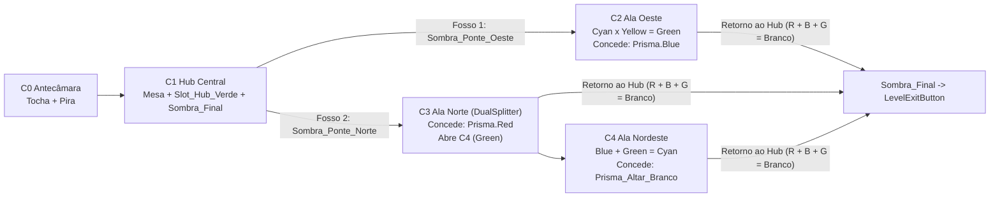

# 🏆 Level Design — Fase 3: *O Santuário do Albedo* (Grand Finale)

Blueprint atualizado da cena [Fase3.unity](file:///E:/AAAAAAAAAAAALBEDO/AAAAAAAAAAAALBEDO/Assets/Scenes/Fase3.unity) (Índice `3` no Build), construída em escala completa (**5 câmaras conectadas, ~62m × 58m**) com prefabs reais e laterais `-X`/`+Z` livres de paredes altas na frente da câmera.

- Retorno: [[MOC - Game Design]]
- Metodologia: [[Framework - Level Design de Puzzles no ALBEDO]]

---

## 1. Identidade & Conceito
- **Nome da Cena:** `Fase3.unity` (*O Santuário do Albedo*)
- **Papel na Campanha:** Clímax integrando **todas** as mecânicas: Fogo Negro (`Tocha` + `Pira`), `WalkableBridge`, filtragem subtrativa (`SingleFilter`), divisão de feixe (`DualSplitter`), convergência aditiva não-branca (`Blue + Green = Cyan`), `Mesa`, `PrismSnapSlot` e convergência final `R + G + B = Luz Branca`.

---

## 2. Topologia em 5 Zonas

| Zona | Coordenadas | Mecânicas e Objetivo |
| :--- | :--- | :--- |
| **Câmara 0 — Antecâmara** | `(0, -24)` | Recolher `Tocha`, acender na `Pira` e usar a `Zona_Pousar_Tocha_F3` ao entrar no Hub. |
| **Câmara 1 — Hub Central** | `(0, -4)` | Exibe `Sombra_Final` (`White, exact=true`) a Leste (`+9, -4`), `Mesa_Hub` (`Luz_Hub_Magenta`), `Slot_Hub_Verde` (`Luz_Hub_Amarela`) e `Vitral_Hub_Verde`. |
| **Fosso 1 + Câmara 2 — Ala Oeste** | `(-24, -4)` | Cruzar `Sombra_Ponte_Oeste` com a `Tocha`; filtrar `Luz_Oeste_Ciano` por `Vitral_Oeste_Amarelo` → **Verde** abre `Sombra_Oeste_Verde` para coletar **`Prisma.Blue`**. |
| **Fosso 2 + Câmara 3 — Ala Norte** | `(0, +18)` | Cruzar `Sombra_Ponte_Norte` com a `Tocha`; usar `Cristal_Divisor_Norte` (`DualSplitter`) sob `Luz_Norte_Amarela`: **Red** (Norte) libera **`Prisma.Red`**; **Green** (Leste) abre a Ala Nordeste. |
| **Câmara 4 — Ala Nordeste** | `(+21, +18)` | Filtrar `Luz_C4_Magenta` em `Vitral_C4_Azul` (**Blue**) e `Luz_C4_Amarela` em `Vitral_C4_Verde` (**Green**); convergir **Blue + Green = Ciano** sobre `Sombra_C4_Ciano` para coletar **`Prisma_Altar_Branco`**. |

---

## 3. Grafo de Dependências

---

## 4. Checklist Estrutural
- [x] **Paredes Camera-Safe:** Lados `-X` e `+Z` abertos com colisores invisíveis e pilares de canto (`Pilar.Tocha` / `Pilar.004`).
- [x] **Zona Neutra para Tocha:** `Zona_Pousar_Tocha_F3` em `(0, -15)` fora do raio de supressão das luzes do Hub.
- [x] **Fiação Visual:** Guias coloridas no piso nas Câmaras 1, 2, 3 e 4 ligando emissores, vitrais e barreiras.
