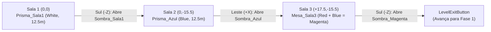

# 🌱 Level Design — Novo Tutorial (3 Salas em "L")

Blueprint atualizado da cena [Tutorial.unity](file:///E:/AAAAAAAAAAAALBEDO/AAAAAAAAAAAALBEDO/Assets/Scenes/Tutorial.unity) (Índice `0` no Build), estruturado em **layout em L de 3 salas** com prefabs reais (`Parede`, `Pilar.Tocha`, `Pilar.004`, `Mesa`, `ALBEDO_LightSpot`, `Prisma.*`) e laterais voltadas à câmera (`-X`/`+Z`) abertas para leitura isométrica limpa.

- Retorno: [[MOC - Game Design]]
- Metodologia: [[Framework - Level Design de Puzzles no ALBEDO]]

---

## 1. Identidade & Conceito
- **Nome da Cena:** `Tutorial.unity` (*O Despertar da Luz*)
- **Mecânica Introduzida:** Manipulação de `PrismaController` (`[E]` pegar/soltar, `[Q]/[R]` girar, `[F]` largar), correspondência de cor exata e introdução à `Mesa` com 2 cores.
- **Anti-Bypass:** O layout faz curva de `90°` (`Sul → Leste → Sul`) e os prismas possuem alcance controlado (`12.5m`–`14m`), impedindo que o prisma branco da Sala 1 abra múltiplas salas em linha reta.
- **Momento "Aha!" Desejado:** *"Preciso deixar o prisma dentro da luz para manter a sombra aberta, combinar a cor certa na direção da próxima porta e usar a mesa para somar duas cores."*

---

## 2. Topologia & Ritmo (*Beats*)

| Sub-área / Beat | Tipo | Intensidade | O que o jogador aprende ou aplica |
| :--- | :--- | :--- | :--- |
| **Sala 1 — Sandbox Branco `(0, 0)`** | `Teach` | `0.15` | Pegar `Prisma_Sala1` (`White`), posicionar em `Luz_Sala1`, girar para o Sul (`-Z`) e abrir `Sombra_Sala1`. |
| **Sala 2 — Curva 90° & Cor Azul `(0, -15.5)`** | `Reinforce` | `0.35` | Usar `Prisma_Azul` sob `Luz_Sala2` apontando para **Leste (`+X`)** para abrir `Sombra_Azul` (`exact=true`) sobre a ponte até a Sala 3. |
| **Sala 3 — Mesa & Síntese Magenta `(+17.5, -15.5)`** | `Combine` | `0.55` | Encaixar `Prisma_S3_Red` + `Prisma_S3_Blue` na `Mesa_Sala3` sob `Luz_Sala3` para formar **Magenta** e abrir `Sombra_Magenta` até `LevelExitButton`. |

---

## 3. Grafo de Dependências

---

## 4. Regras de Câmera & Checklist Anti-Softlock
- **Paredes Camera-Safe:** Apenas lados posteriores (`+X` Leste e `-Z` Sul) têm `Parede.prefab`; lados frontais (`-X` Oeste e `+Z` Norte) usam colisores invisíveis e `Pilar.Tocha` / `Pilar.004` nos cantos. A porta entre Sala 2 e Sala 3 usa pilares + `Sombra_Azul` sem parede alta bloqueando a Sala 3.
- [x] **Zero Linha Reta:** Curva `90°` + `godRayLength = 12.5m` bloqueia qualquer varada direta da Sala 1 para Sala 2/3.
- [x] **Zero Soft-Lock de Transporte:** Cada sala possui suas próprias fontes e prismas independentes.
