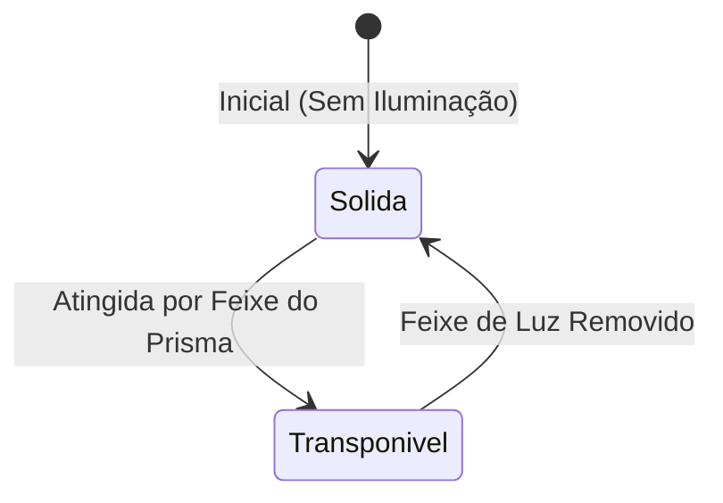

# 🌑 Mecânica de Sombras e Puzzles

As sombras atuam como portas e bloqueadores de avanço fundamentais no design de fases do ALBEDO.

- Retorno: [[MOC - Game Design]]
- Implementação Técnica: [[Script - SombraController]]

---

## 🚪 Comportamento das Sombras

1. **Estado Normal (Sólido)**:
   - Os colisores da sombra possuem `IsTrigger = false`.
   - Bloqueia a passagem do jogador ([[Script - PlayerController]]) e de objetos físicos.
   - Renderers visíveis (aparência escura / opaca).

2. **Estado Iluminado (Transponível)**:
   - Quando o raio do [[Script - PrismaController]] atinge a sombra:
     - Os colisores tornam-se `IsTrigger = true` (permitindo passagem do jogador sem quebrar detecção).
     - Os renderers são ocultados (`renderers[i].enabled = false`).
     - Dispara o evento Unity `onShadowHidden`.

3. **Restauração**:
   - Assim que o feixe se afasta, a sombra volta a ser sólida e dispara `onShadowRevealed`.
