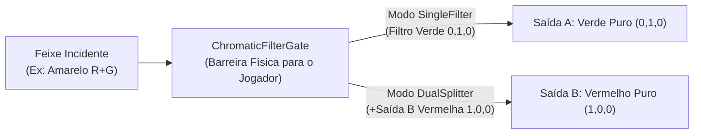

# 🪟 Mecânica de Vitrais e Divisores Cromáticos

A mecânica de **Vitral / Filtro Cromático & Divisor de Feixe** introduz a **filtragem subtrativa RGB** e a **bifurcação de feixes luminosos** aos quebra-cabeças do **ALBEDO**.

- Retorno: [[MOC - Game Design]]
- Implementação Técnica: [[Script - ChromaticFilterGate]], [[Script - PrismaController]]
- Aplicação em Nível: [[Level Design - Fase 2 O Claustro dos Vitrais]]

---

## 🎯 Conceito Central

Enquanto os prismas móveis realizam a **síntese aditiva** (somando feixes `R + G + B = Branco`), o **Vitral Cromático (`ChromaticFilterGate`)** atua como uma **barreira física sólida para o jogador e objetos carregados**, mas **seletivamente permeável à luz**:

1. **Bloqueio de Transporte**: O jogador não pode atravessar o vitral carregando prismas ou a Tocha de Fogo Negro (`isTrigger = false`). Para levar luz ao outro lado, é preciso projetá-la *através* do cristal.
2. **Filtragem Subtrativa (`SingleFilter`)**: O feixe incidente é multiplicado pela cor do filtro (`incoming * filterColor`), bloqueando os canais que não pertencem ao vitral.
3. **Divisão de Feixe (`DualSplitter`)**: Um único feixe composto é decomposto simultaneamente em até **2 saídas** com cores e ângulos horizontais (`yawOffsetA` e `yawOffsetB`) independentes.

---

## 🌈 Tabela Verdade de Filtragem Subtrativa

| Cor Incidente | Filtro do Vitral | Cor Resultante Emitida | Observação |
| :--- | :--- | :--- | :--- |
| **Branco** `(1,1,1)` | **Verde** `(0,1,0)` | **Verde** `(0,1,0)` | Extrai apenas o canal G |
| **Amarelo** `(1,1,0)` | **Verde** `(0,1,0)` | **Verde** `(0,1,0)` | Remove o canal Vermelho |
| **Amarelo** `(1,1,0)` | **Vermelho** `(1,0,0)` | **Vermelho** `(1,0,0)` | Remove o canal Verde |
| **Amarelo** `(1,1,0)` | **Azul** `(0,0,1)` | **Apagado** `(0,0,0)` | Não há canal Azul na luz amarela |
| **Branco** `(1,1,1)` | **Ciano** `(0,1,1)` | **Ciano** `(0,1,1)` | Passam os canais G e B |
| **Magenta** `(1,0,1)` | **Ciano** `(0,1,1)` | **Azul** `(0,0,1)` | Interseção entre R+B e G+B |
| **Ciano** `(0,1,1)` | **Amarelo** `(1,1,0)` | **Verde** `(0,1,0)` | Interseção entre G+B e R+G |
