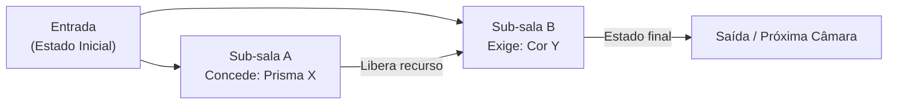

# 📋 Template — Blueprint de Câmara de Puzzle (ALBEDO)

Ficha padrão para projetar novas câmaras ou refatorar salas existentes antes da implementação no Unity Editor.

- Retorno: [[MOC - Game Design]]
- Metodologia: [[Framework - Level Design de Puzzles no ALBEDO]] | [[Estudo - Level Design de Portal 2 (Abram e Valve)]]

---

## 1. Identidade & Conceito
- **Nome da Câmara / Cena:** `<Ex: Câmara X — Nome Temático>`
- **Mecânica Introduzida (máx. 1):** `<Ex: DualSplitter / Supressão de Ponte com Tocha / Nenhuma (apenas síntese)>`
- **Mecânicas Combinadas:** `<Ex: LightSource + PrismaController + SombraController>`
- **Momento "Aha!" Desejado:** `<Descrever em 1 frase a descoberta que o jogador precisa ter>`

---

## 2. Topologia & Ritmo (*Beats*)
- **Topologia Espacial:** `<Linear Pura | Linearidade Guiada | Hub Não-Linear + Antecâmara | Loop com Backtracking>`

| Sub-área / Beat | Tipo (`Teach` / `Reinforce` / `Combine` / `Rest` / `Climax`) | Intensidade (0.0–1.0) | O que o jogador aprende ou aplica |
| :--- | :--- | :--- | :--- |
| `<Entrada / Sandbox>` | `Teach` | `0.2` | `<Regra isolada sem risco>` |
| `<Área Principal>` | `Reinforce` / `Combine` | `0.6` | `<Aplicação combinada>` |
| `<Transição / Saída>` | `Rest` / `Climax` | `0.8` | `<Fechamento ou respiro>` |

---

## 3. Design Reverso (Saída → Entrada)
1. **Estado Final da Saída:** `<O que abre a Sombra/Botão de saída? Ex: Luz Branca na Sombra_Saida>`
2. **Pré-requisitos Imediatos:** `<Quais feixes, cores, vitrais ou tocha precisam estar ativos/posicionados?>`
3. **Origem dos Recursos:** `<Onde cada prisma, fonte de luz ou braseiro nasce na sala?>`
4. **Estado Inicial da Entrada:** `<Como o jogador encontra a câmara no segundo 0>`

---

## 4. Grafo de Dependências

---

## 5. *Sightlines* & Fiação Visual Diegética
- **Enquadramento na Entrada (`CameraTriggerZone`):** `<Quais elementos precisam aparecer juntos no primeiro olhar?>`
- **Informação Oculta Intencionalmente:** `<O que fica fora de vista ou atrás de divisória até o passo 2?>`
- **Comunicação de Causa → Efeito (Sem Texto):** `<Cores das sombras, direção dos GodRays, marcas no piso ligando PrismSnapSlot / Vitral → Sombra>`

---

## 6. Checklist Anti-Ruído & Anti-Softlock
- [ ] **1 Conceito Novo:** Não exige descobrir duas interações inéditas ao mesmo tempo.
- [ ] **Sandbox Seguro:** Se a regra for nova ou sutil, há espaço isolado para testá-la primeiro.
- [ ] **Peças com Função:** Nenhum objeto, luz ou vitral sobrando gera falsa pista (*overcomplication*).
- [ ] **Zero Soft-Lock de Transporte:** Itens necessários em câmaras futuras não ficam presos atrás de vitrais/sombras fechadas.
- [ ] **Zona Neutra (se houver Tocha):** Existe local seguro para pousar a `Tocha` sem apagar acidentalmente um GodRay necessário.
- [ ] **Precisão Confortável:** Alinhamentos críticos usam `PrismSnapSlot` ou margem tolerante.
