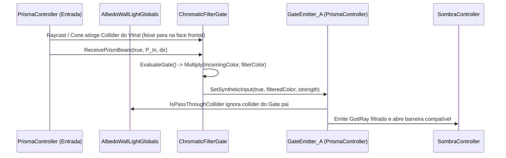

# 🪟 Script: `ChromaticFilterGate.cs` & `PrismSnapSlot.cs`

- **Arquivos no Projeto**:
  - `Assets/Scripts/ChromaticFilterGate.cs` (~222 linhas)
  - `Assets/Scripts/PrismSnapSlot.cs` (~191 linhas)
- **Retorno**: [[MOC - Arquitetura e Scripts]]
- **Conceito de Design**: [[Mecânica de Vitrais e Divisores Cromáticos]] | [[Level Design - Fase 2 O Claustro dos Vitrais]]

---

## ⚙️ Funcionamento Técnico de `ChromaticFilterGate`

### Parâmetros Principais (`ChromaticFilterGate`)
- **`gateMode`**:
  - `SingleFilter`: ativa apenas `GateEmitter_A`.
  - `DualSplitter`: ativa `GateEmitter_A` e `GateEmitter_B` com filtros e ângulos independentes.
- **`filterPresetA` / `filterPresetB`**: define o filtro RGB (`Red`, `Green`, `Blue`, `Yellow`, `Cyan`, `Magenta`, `White` ou `Custom`).
- **`yawOffsetA` / `yawOffsetB`**: ângulo horizontal (em graus) aplicado ao feixe de saída.
- **`alignToIncomingBeam`**:
  - `true`: o feixe filtrado acompanha a direção do feixe que entrou no vitral (`+ yawOffset`).
  - `false`: usa o eixo frontal fixo (`transform.forward`) do vitral/cristal (`+ yawOffset`). Ideal para divisores fixos de fase.
- **`exitThicknessOffset`**: deslocamento à frente do ponto de saída para impedir que o feixe gerado colida com a própria malha do vitral.
- **Proteção contra Loops**: `HasUpstreamSource` e `OwnsEmitter` bloqueiam ciclos recursivos entre múltiplos vitrais e prismas encadeados.

---

## 🧲 Funcionamento Técnico de `PrismSnapSlot`

- Registra-se automaticamente em `PrismSnapSlot.AllSlots`.
- Detectado por [[Script - PlayerController]] quando o jogador segura um `PickableObject` compatível dentro de `snapRadius`, exibindo `[E] Encaixar`.
- Ao apertar `[E]` (ou soltar dentro do raio com `autoSnapOnDropNearby = true`), trava o prisma em `isKinematic = true` na posição e direção (`Yaw`) do slot preservando a inclinação FBX original (`preservePrismUprightTilt`), e libera o slot ao pegar o prisma de volta com `[E]`.
